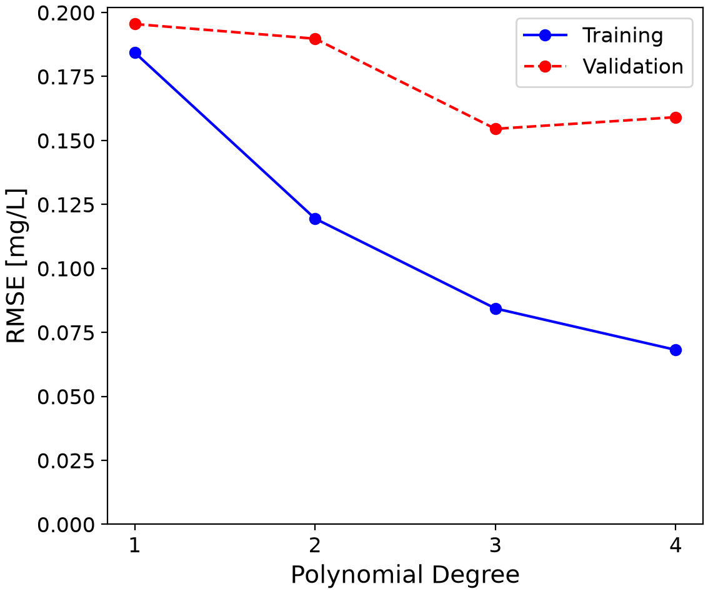
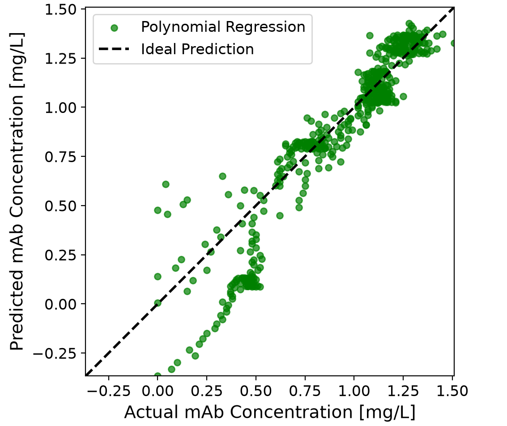
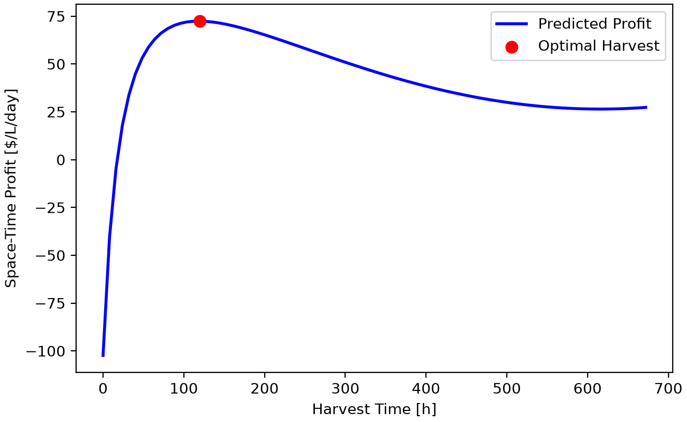
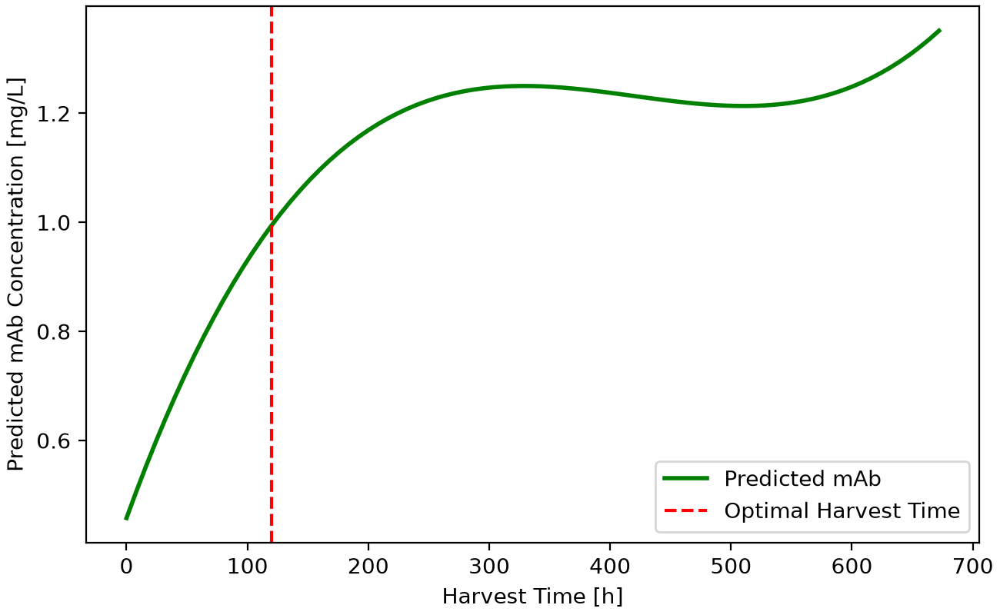

# Optimizing Monoclonal Antibody Production

This project uses machine learning to optimize monoclonal antibody (mAb) production by determining the initial glucose concentration, glutamine concentration, viable cell density and harvest time that maximize space-time profit. A dataset of 30 selected production batches is used to train and compare polynomial and KNN regression models. The program evaluates different operating conditions, estimates prediction uncertainty and exports figures and CSV results.

## Highlights
- Selected 30 unique production batches from 1,029 available batches

- Built polynomial and KNN regression models to predict mAb concentrations

- Optimized model hyperparameters using four-fold grouped cross-validation

- Identified operating conditions that maximize space-time profit

- Estimated 95% prediction intervals and exported figures and CSV results

## Environment
- Python 3.14.7
- Matplotlib 3.11.0
- NumPy 2.5.2
- pandas 3.0.5
- scikit-learn 1.9.0

## Code Design

### Dataset Import and Preparation
The program begins by importing the initial conditions csv dataset using the pandas library. The dataset contains 1,029 production batches with different initial glucose concentrations, glutamine concentrations and viable cell densities (VCD). Since multiple batches share the same initial conditions, the drop_duplicates() method is used to identify unique combinations of the three operating variables

From these unique combinations, 30 batches are randomly selected using the sample() method with the parameter random_state=42 which ensures reproducibility. Each selected batch contains time-series data that describes the cell culture, including antibody concentration. The selected batch files are copied into a seperate folder and combined into a single DataFrame using pd.concat().

The initial operating conditions and batch identifiers are added to the combined dataset, allowing the data to be used for regression and validation methods.

### Preprocessing and Cross-Validation

The combined dataset contains 2,550 observations from 30 selected batches, with 85 time points per batch. The four input features are initial glucose concentration, initial glutamine concentration, initial viable cell density (VCD) and harvest time. The target variable is monoclonal antibody (mAb) concentration in mg/L.

The data is divided into 24 training batches and 6 testing batches. Unlike a random split of individual observations, separating entire batches prevents time points from the same batch from appearing in both datasets.

Each regression model uses a pipeline containing StandardScaler() to standardize the input features. This is particularly important for KNN regression because it calculates distances between observations. The pipeline also ensures that scaling is fitted only on the training data during validation.

Four-fold cross-validation is performed using GroupKFold(), with batch identifiers defining the groups. This ensures that all observations from a batch remain together in either the training or validation portion of each fold, reducing data leakage and providing a more reliable estimate of model performance on unseen batches.

### Regression Models

Two regression models were implemented to predict monoclonal antibody concencrations and compare their predictive performance.

Polynomial regression was implemented using PolynomialFeatures() and LinearRegression() to account for nonlinear relationships and interactions between the four input features. GridSearchCV() was used to evaluate polynomial degrees ranging from 1 to 4 and select the degree with the lowest validation RMSE.

KNN regression was implemented using KNeighborsRegressor(), which predicts antibody concentrations based on nearby observations. GridSearchCV() evaluated neighbor counts ranging from 1 to 80, along with uniform and distance weighting methods, resulting in 160 hyperparameter combinations.

Both models used four-fold grouped cross-validation and negative RMSE as the scoring metric. The optimized models were then evaluated using the independent testing dataset to compare their ability to predict antibody concentrations for unseen production batches.

### Model Evaluation and Visualization

The optimized regression models were evaluated using the independent testing dataset. Root mean squared error (RMSE) and the coefficient of determination (R²) were calculated to assess predictive performance. RMSE measures the magnitude of prediction errors, while R² indicates how much variation in antibody concentration is explained by the model.

Four figures were generated using Matplotlib. The first shows training and validation RMSE across polynomial degrees, while the second compares actual and predicted antibody concentrations. The remaining figures display predicted space-time profit and antibody concentration against harvest time for the selected optimal initial conditions.

These figures help visualize model accuracy and demonstrate how harvest time influences antibody production and economic performance.

### Economic Optimization

The best-performing regression model is used to predict antibody concentrations across different operating conditions. The program evaluates 29,155 combinations of initial glucose concentration, glutamine concentration, viable cell density and harvest time using itertools.product().

For each combination, the predicted antibody concentration is used to calculate the culture value and profit per litre. The culture cost is determined from the initial glucose, glutamine and viable cell density. Space-time profit is then calculated by dividing profit by the total production time, including one additional day of downtime between batches.

The operating conditions producing the highest predicted space-time profit are selected as the optimal conditions. This approach considers both antibody production and economic performance rather than simply maximizing antibody concentration.

### Uncertainty Estimation and Exporting Results

Prediction uncertainty is estimated using residual resampling. The program calculates the differences between predicted and actual training values, then randomly samples these residuals over 1,000 simulations to estimate approximate 95% prediction intervals for antibody concentration, profit and space-time performance.

The program also exports the selected datasets, model comparison results and economic calculations into CSV files. Four figures are saved in the figures directory, allowing the results to be reviewed without rerunning the program.

## Analysis

### Polynomial Regression

Polynomial regression was evaluated using degrees ranging from 1 to 4 to determine whether nonlinear relationships between the operating variables and antibody concentration would improve predictive accuracy.

The third-degree polynomial achieved the lowest validation RMSE of 0.15454 mg/L, making it the best-performing polynomial configuration. This suggests that nonlinear relationships and interactions between initial glucose concentration, glutamine concentration, viable cell density and harvest time are important when predicting monoclonal antibody production.

The figure shows how training and validation RMSE change with polynomial degree. Although the fourth-degree polynomial produced a lower training error, its validation error increased compared with the third-degree model. This suggests possible overfitting, where increasing model complexity improves performance on training observations but reduces its ability to generalize to unseen batches.

The third-degree polynomial therefore provided the best balance between model complexity and validation performance among the degrees tested.

### Comparison of Regression Models

Polynomial regression and KNN regression were compared using four-fold grouped cross-validation and an independent testing dataset. Root mean squared error (RMSE) was used as the primary evaluation metric, where lower values indicate better predictive accuracy.

| Regression Model | Validation RMSE (mg/L) | Test RMSE (mg/L) | Test R² |
|---|---:|---:|---:|
| Polynomial Regression (Degree 3) | 0.15454 | 0.16770 | 0.76076 |
| KNN Regression (k = 12, Distance) | 0.15584 | 0.18851 | 0.69770 |

Polynomial regression achieved the lowest validation RMSE of 0.15454 mg/L, slightly outperforming KNN regression at 0.15584 mg/L. Although both models performed similarly during cross-validation, the difference was more noticeable on the testing dataset.

The third-degree polynomial achieved a test RMSE of 0.16770 mg/L and an R² of 0.76076, indicating that it explained approximately 76.1% of the variation in antibody concentration within the testing dataset. KNN achieved a higher test RMSE of 0.18851 mg/L and a lower R² of 0.69770.

Polynomial regression reduced the test RMSE by approximately 11.0% compared with KNN. Based on its better validation and testing performance, the third-degree polynomial was selected for economic optimization.

### Actual vs Predicted Antibody Concentrations

The optimized third-degree polynomial regression model was evaluated using the independent testing dataset, containing 510 observations from six production batches. The model achieved a test RMSE of 0.16770 mg/L and an R² of 0.76076, indicating reasonably good predictive performance on unseen batches.

The diagonal line represents ideal predictions, where predicted antibody concentrations equal actual concentrations. Points above the line indicate overpredictions, while points below indicate underpredictions. The spread of observations around this line demonstrates that prediction errors remain despite the model's relatively strong R².

Some predicted concentrations are negative, which is not physically possible. This highlights a limitation of polynomial regression, as the model does not enforce nonnegative antibody concentrations. Therefore, its predictions should be interpreted cautiously, particularly when evaluating operating conditions outside well-represented regions of the dataset.

### Economic Optimization Results

The optimized third-degree polynomial regression model was used to evaluate 29,155 combinations of initial operating conditions and harvest times. The objective was to maximize space-time profit rather than simply maximize antibody concentration.

The optimal operating conditions were an initial glucose concentration of 20 mM, glutamine concentration of 3 mM, viable cell density of 600,000 cells/mL and harvest time of 120 hours (5 days). At these conditions, the model predicted an antibody concentration of 0.99442 mg/L.

The calculated culture cost was \$560/L, while the predicted culture value was \$994.42/L, resulting in a profit of \$434.42/L. Accounting for the five-day production period and one additional day of downtime, the maximum predicted space-time profit was \$72.40/L/day.

Figure 3 shows how predicted space-time profit changes with harvest time while maintaining the optimal initial conditions. Space-time profit reaches its maximum at 120 hours before decreasing at longer harvest times. Although extending the culture period can increase antibody production, the additional time reduces the frequency of production cycles.

This demonstrates why maximizing antibody concentration alone does not necessarily produce the most economically favourable operating conditions.

### Antibody Concentration vs Harvest Time

The relationship between harvest time and predicted antibody concentration was also examined using the optimal initial operating conditions. Unlike space-time profit, antibody concentration generally increases as the culture progresses.

Figure 4 shows that the predicted antibody concentration at the optimal harvest time of 120 hours is approximately 0.99442 mg/L. However, the model predicts higher concentrations at later harvest times, reaching approximately 1.25 mg/L around 320 hours.

Despite the higher antibody concentration, harvesting later does not maximize space-time profit. Longer production cycles reduce the number of batches that can be completed over a given period, while additional antibody production may not compensate for the extra time.

The curve also shows some unusual behaviour at longer harvest times, including a decrease followed by another increase. This may be an artifact of polynomial regression rather than a realistic biological trend, highlighting the importance of interpreting model predictions cautiously.

### Prediction Uncertainty and Model Limitations

Prediction uncertainty was estimated using residual resampling with 1,000 simulations at the optimal operating conditions. The approximate 95% prediction interval for antibody concentration was 0.84448–1.11929 mg/L, while the corresponding profit interval was \$284.48–\$559.29/L. Space-time profit ranged from $47.41 to \$93.21/L/day, indicating that economic performance may vary considerably due to prediction uncertainty.

These intervals were estimated using residuals from the training dataset rather than independent testing observations. Consequently, they may underestimate uncertainty when predicting unseen production batches. They also represent uncertainty at the selected operating conditions rather than uncertainty in which conditions are truly optimal.

Additional limitations include the relatively small selection of 30 batches and the inability of polynomial regression to enforce physically realistic predictions. Some predicted antibody concentrations were negative, and the predicted concentration curve displayed unusual behaviour at longer harvest times.

The uncertainty intervals are important when evaluating the reliability of the optimized operating conditions. Although the predicted space-time profit is positive, the interval indicates that the actual economic outcome could differ substantially from the estimated value. The model also assumes that the operating cost remains constant for a given set of initial conditions, without accounting for additional process costs or unexpected changes during cultivation. Furthermore, the optimization is based on model predictions rather than experimental measurements at every candidate condition. Consequently, the identified optimum should be considered a preliminary recommendation rather than a guaranteed maximum. Additional experiments near the recommended conditions would help determine whether the predicted economic advantage can be reproduced.

Overall, the third-degree polynomial provided better predictive performance than KNN and identified operating conditions with a maximum predicted space-time profit of $72.40/L/day. However, the recommended conditions should be experimentally validated before being implemented in an actual bioreactor process.